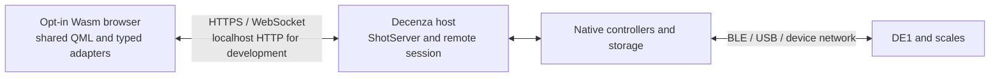

# Design

## Context

See [proposal.md](proposal.md) for the motivation and staged migration scope. The maintainer clarified on 2026-10-21 that two web interfaces are temporary: the target is one Wasm interface sharing native QML and behavior, with HTML retired in a follow-up after validation. References below to additive rollout describe this transition, not indefinite support for both frontends.

### Routing decision (2026-10-22)

The Wasm app is the default root document at `/`. `/wasm/` remains a compatibility alias to the same Wasm app. Existing HTML pages move under `/legacy/`; non-root bookmarks redirect to the corresponding prefixed page while preserving identifiers and supported query parameters. The HTML implementation remains available in this change. Keep `/api/...`, authentication, file, download, and upload contracts stable; prefix legacy page navigation and form destinations only where those are HTML routes. Earlier additive `/wasm/`-only and default-HTML statements in this plan describe historical rollout decisions and are superseded by this section. Evaluation entries remain historical evidence and are not rewritten.

The current build requires Bluetooth, TextToSpeech, SQL, multimedia, and platform services together with QML. Desktop branches also require SerialPort and OpenSSL (`CMakeLists.txt`). `src/main.cpp` constructs and connects the native application. Compiling that executable wholesale for the browser would bring along services that belong on the DE1-connected host.

QML uses concrete local objects through compile-time singleton registration (`src/core/contextsingletons_qml.h`). `EspressoPage.qml` directly reads `DE1Device`, `MachineState`, and `MainController`; `ShotGraph.qml` includes the custom `FastLineRenderer`. This makes the real cost the presentation boundary, not merely obtaining a Wasm binary.

ShotServer already provides management pages, REST handlers, authentication, and layout/theme event streams. Its `/api/state` and `/api/telemetry` expose a useful subset of live state. `/api/command` currently accepts wake/sleep only; existing MCP control handlers demonstrate native operation paths but are not a complete browser protocol. `/remote` is a scrcpy help page, not an existing browser remote desktop.

Some web features exceed their native equivalents: for example, the native theme page directs users to the web editor for more controls. A port must inventory actual web behavior rather than assume reproducing native pages is sufficient.

Qt documents QML, Quick, Graphs, and WebSockets support, mobile browsers, browser-local file APIs, and networking restrictions. These establish plausibility, not Decenza compatibility. Use the pinned Qt release and its matching Emscripten version; verify actual rendering and imports on devices. References: [Qt for WebAssembly](https://doc.qt.io/qt-6/wasm.html), `docs/CLAUDE_MD/SHOTSERVER.md`, and `docs/CLAUDE_MD/QML_GOTCHAS.md`.

## Goals / Non-Goals

### Governing implementation scope (2026-10-21)

The maintainer requires parity for **all app QML**, including pages, settings tabs, controls, dialogs, overlays, configurable widgets, screensavers, simulator UI and supporting scripts/assets. Sections below describing the original experiment and staged authorizations record how work began; they do not narrow this scope. The file inventory at the end of this design assigns every current application QML/script file to a task group. New files must join that inventory in the same change. There is no automatic exclusion for a native singleton dependency, a `Native` filename prefix, an optional widget, or a rarely used route.

Qt Remote Objects shared services are the established integration pattern. Native and Wasm use the same QML-facing service and presentation source; the native host owns hardware, persistence and integrations. Retain only necessary platform bootstrap, browser transport, file-picker/download and OS adapters. A host-only producer such as `SessionAppearancePublisher` stays host-owned and is explicitly audited; that does not exclude any user-facing appearance control. Where a browser capability cannot match native behavior, record the exact limitation and obtain a decision before claiming parity or dropping the feature. Browser Quit is already explicitly specified as ignored.

Implementation and simulator validation continue on this Mac. Remote HTTPS, mobile devices, screen readers and supervised real hardware remain separate release gates. The historical 59/118 task count mixed feasibility milestones, overlapping feature umbrellas and deferred gates, so it must not be presented as overall product completion. Report verified workflow groups and their remaining actions; distinguish source inclusion, build success, runtime reachability, and accepted behavior.

Screensaver behavior (maintainer decision, 2026-10-22): preferences and media are shared with the host, while each screen enters and dismisses its own screensaver independently. Touching the browser dismisses only its screensaver. Browser dimming uses a local visual overlay because physical display brightness is unavailable to webpages. Explicit machine Sleep/Wake commands remain host-owned; browser activity does not change the native display or its BLE reconnect policy.

### Current evaluation scope (maintainer direction, 2026-10-20)

Begin on the development Mac. The initial browser Wasm process talks over localhost HTTP to the **separate native Qt Decenza application on the same Mac**, with its DE1 simulator enabled. Browser-local simulation is not a substitute. This loopback probe and its existing single-thread Wasm build are historical development baselines, not the remote-access security target or a decision about threading. Remote deployments target a browser-trusted HTTPS origin. Use the existing repository and root CMake project with separate macOS and WebAssembly kit/build directories.

Before extracting production presentation code, run a bounded Phase 0 toolchain/transport probe with typed state/telemetry reads. A temporary loopback-only server may serve the bundle and proxy those two read-only endpoints without changing ShotServer or its CORS policy. This proves neither production bundle hosting nor authentication compatibility.

The original remote Android host, real phone/tablet, accessibility, and physical-machine checks below remain acceptance requirements for broad use, but are deferred for this first evaluation at the maintainer's request. On 2026-10-20, after the Mac graph evidence was reviewed, the maintainer authorized one bounded shared text/suggestion control slice for the additive Wasm interface. That work can establish a Mac-only production-control seam; it does not pass Gate 0 or Gate 1 or satisfy the deferred cross-device acceptance requirements. Record a Mac-specific recommendation and outstanding evidence explicitly.

The maintainer subsequently authorized investigating/fixing the popup accessibility gap and continuing the additive interface. Continue with a bounded read-only live equipment list from the existing API while preserving the deferred gates. A stock-Qt browser-shell workaround may correct the accessibility DOM, but a passing browser-tree check is not a substitute for real screen-reader/device acceptance.

The maintainer accepted one shared active preparation workflow across native and Wasm interfaces: espresso, steam, hot water, or flush. The selected workflow and preparation settings are host-owned and update across interfaces. This shared state does not synchronize page navigation: selecting a workflow updates preparation controls but never navigates a client away from an editor, history/search view, dialog, or unsaved draft, and selecting it never starts a machine operation. Bean and milk capture are host-owned so remote telemetry cannot start a second capture timer or apply settings twice. The HTML interface remains available under `/legacy/` with its workflow behavior preserved.

The maintainer then authorized continued Mac-only implementation without pausing after each slice. Build a navigable second interface and a real equipment-name edit first. Reuse the existing shared text field and host rename rules; correlate each HTTP response to its own storage operation and compare the original name before writing. Require the packaged host to support the precondition; a missing feature is a protocol error. This provides an additional persisted-edit proof, without substituting for the planned recipe workflow or passing the deferred session/device gates.

Continue with the planned session transport as a bounded Mac slice: HTTP compatibility preflight plus a same-origin WebSocket on the existing native listener, ordered coherent read-only snapshots, explicit reconnect, and stale-state gating of equipment edits. Reuse the existing authentication and request guard. Verify this slice through focused native tests and the loopback browser; retain separate acceptance tasks for remote HTTPS, real devices and host-impact measurements.

The earlier same-origin HTTP full-snapshot graph adapter is retired; its measurements remain historical evidence. The
production Espresso graph path now uses a generated Qt Remote Objects service shared by the
native and Wasm builds: a bounded full snapshot establishes an epoch/sequence baseline, then
ordered append deltas carry new samples; reset/correction deltas replace the graph. The shared
`ShotGraph` and `FastLineRenderer` remain the presentation path, with renderers appending normal
samples and resetting only on baseline/reset. Retain the old HTTP measurements as comparative
evidence, not as the production transport design. The current service/source implementation is
validated by the paired Mac build, twelve focused suites and simulator mid-shot reload checks recorded in evaluation.md; remaining view and cross-device checks stay open.

**Goals**

- Complete native-app look, feel and functionality through the same production QML files, with explicit implementation and validation coverage for the full inventory.
- Reuse shared Qt Remote Objects services and canonical host operations; remove superseded browser-specific domain code as each slice lands.
- Complete all browser workflows without weakening native control or creating a second persistent database.
- Evaluate desktop, phone, and tablet use in the planned device gates after the Mac-first preflight.

**Non-goals**

- Browser Bluetooth/USB, moving brewing algorithms into a browser, streaming pixels, or controlling the native screen's navigation.
- Arbitrary invocation of every native QObject method. Expose supported host operations through shared services; native-app UI parity is a goal.
- A new internet relay, offline browser editing, automatic mutation replay, or changing existing machine-control policies.
- Replacing small bootstrap, authentication, and recovery HTML pages just to claim zero HTML.
- Retiring the existing HTML/JavaScript implementation. This change does change the root default and remaps legacy page routes under `/legacy/`; deleting the HTML implementation remains future scope requiring a separate decision.

## Decisions

### 1. The browser is a remote presentation client

“Host” means the native Decenza device connected to the DE1, normally the tablet. A separate computer, phone, or tablet loads the application from that host's URL. The browser keeps local navigation, editor/history/search state, dialogs, and unsaved form state; active preparation workflow selection and host data are shared and authoritative.

Serve the Wasm interface at `/` and retain `/wasm/` as an alias on the same host origin for assets, REST, and updates. Move native HTML pages to `/legacy/`, with redirects or compatible aliases for existing non-root page bookmarks. Preserve query and record context across redirects. Keep API, authentication, upload, and download routes independent of the HTML page prefix. Remote access uses HTTPS with a certificate the browser trusts; local development may use HTTP on localhost. The browser needs network reachability, not proximity to the machine or permission to access its hardware. Same-network deployment is the first validation environment, but plain LAN HTTP is not the remote-use target. A host reached through an existing tunnel uses the same architecture, but tunnel routing/authentication must be verified before claiming internet support.

Alternative: screen streaming could reuse `ScreenCaptureService`, but it shares the native screen and does not achieve the requested independent QML client. Keep it as an alternative if the second interface does not meet its gates.

### 2. Preparation selection is shared; navigation and drafts are not

Native and Wasm interfaces observe and change one host-owned active preparation workflow: espresso, steam, hot water, or flush. A selection updates the corresponding preparation controls on every interface, but it is not a navigation command and does not start the machine. Each interface retains its own route, editor/history/search state, dialogs, and unsaved drafts. The HTML interface remains available under `/legacy/` with its workflow behavior preserved.

The host owns the bean/milk capture state machine, measured values, and any resulting settings/device writes. Shared QML consumes that authoritative state through a typed backend; browser clients do not run a second stable-weight timer, calculate or persist capture outcomes locally, or replay capture commands after reconnect. Capture ownership must be singular across native and remote clients. The backend reports active/captured/rejected/cancelled outcomes so shared screens can render the same feedback without duplicating device work.

### 3. Separate platform builds with one shared presentation source

Add a browser entry point and narrowly scoped source/resource lists. Keep native services out of the target: BLE/USB discovery, MQTT sockets, embedded Tailscale, local servers, firmware installers, native crash/update hooks, and persistent host databases. Audit transitive includes as well as link libraries: excluding a `.cpp` does not remove a native type referenced by a registered QML property.

Use the current single-threaded browser build and its measured graph/load/input results as the baseline. Do not switch to a thread-enabled Qt build solely to optimize a metric that has not shown a bottleneck, and do not retain single-threading solely to avoid HTTPS: HTTPS is the preferred remote target either way. Only investigate a thread-enabled comparison if measurements identify a bottleneck that worker threads could plausibly improve or a specific justified benefit. Qt 6.12 documents that Wasm threads require SharedArrayBuffer, a secure context, and cross-origin isolation using COOP/COEP headers; localhost is also a secure context for development. If a comparison is warranted, use equivalent workloads and record any compatibility and mobile-hosting costs. No performance benefit is assumed. [Qt for WebAssembly, Qt 6.12](https://doc.qt.io/qt-6/wasm.html); [Emscripten Pthreads](https://emscripten.org/docs/porting/pthreads.html).

Implement the complete inventory in dependency-ordered slices. Share QML-facing services between native and Wasm rather than writing a browser adapter per page; extend existing service owners and extract common operation/conflict handling. Register types with the project's compile-time QML conventions and retain lint coverage. Do not use dynamic untyped maps as a wholesale replacement for the current typed interface.

Shared components must be consumed by both the native app and the Wasm target. A copied browser version of `ShotGraph` or an inventory editor does not demonstrate maintenance value. Reuse domain calculations where portable, but keep validation and writes on the host. Local presentation preferences can remain per-browser; domain settings and existing shared preferences, including inventory sort, remain host-owned. The existing HTML interface does not need to be migrated or replaced in this change.

Alternative: stub all native singletons and port the whole application. Rejected for the experiment because it hides the eventual adapter cost and creates a large rewrite before any usability evidence.

### 4. Reuse shared host services and the matched session

Use the established shared Qt Remote Objects services for application domains, with the matched session for initial identity, telemetry and resource delivery. Reuse existing REST/file endpoints where appropriate for uploads/downloads and retain them for current HTML/API clients. Do not reintroduce separate browser inventory/editor implementations. Keep the socket on the browser's main thread as required by Qt's documented Wasm limitations.

The Wasm client and native host are built and shipped as one package, not independently versioned products. The session handshake requires an exact package identity as well as protocol compatibility, host-instance identity, required features, and initial state revision. The browser connects only to its serving origin. Missing or mismatched package identity rejects the connection; there is no older-host read-only compatibility mode. A stale cached tab must reload the packaged bundle before using the host. During local development both kit builds derive their identity from the same source/resource/build-recipe contents, including uncommitted changes. Updates carry ordering information; after a gap or host restart, discard obsolete state and fetch a fresh snapshot. Subscribe only to needed domains. Bound queues and telemetry history; a slow client receives a resync or disconnect instead of unlimited buffered samples. Initial live state includes accumulated samples so a mid-shot join does not start an empty graph.

Reuse the native services behind existing endpoints when adding missing operations. Do not route a human UI through AI-oriented MCP tool descriptions, or duplicate controller logic. Gate 2 needs only one control operation on a simulator plus one persisted edit; production machine controls are added only with their native validations and access policy intact.

For forms, send a baseline/revision plus changed fields. Add opt-in conflict checking for the new client, accounting for native and legacy writers as well as other browsers. Preserve existing API behavior for clients without that precondition. The current bag edit-diff contract remains authoritative for unrelated changes. No reconnect automatically resends an edit or a machine action; uncertain results are shown and reconciled first.

Alternative: polling can provide a temporary diagnostic baseline, but a live full graph, domain invalidation, and resume must be proven with the selected subscription design before passing Gate 2. Avoid inventing polling guards to mask race conditions.

### 5. Serve the second interface additively from ShotServer

Serve the Wasm entry document at `/` and the same client at `/wasm/`. Serve HTML pages under `/legacy/`; redirect existing non-root HTML page bookmarks to their `/legacy/` equivalents while preserving query parameters and identifiers. Keep `/api/...`, authentication, database/file downloads, upload endpoints, and static resources compatible; route generated legacy links and form actions to `/legacy/` only when they target HTML pages or HTML-owned endpoints. Serve the packaged bundle with correct MIME types, precompressed assets where supported, and no required CDN. Package a manifest with the shared package identity, application and protocol versions; immutable assets use content hashes, while the bootstrap/manifest revalidate. Defer service workers to avoid another cache lifecycle during evaluation.

Enforce the existing host/origin/authentication rules for HTTP and WebSocket upgrades, including session expiry. Remote use requires a browser-trusted HTTPS origin; localhost HTTP remains valid for development. Do not widen CORS or exempt the new API. Stored provider keys never enter general snapshots; integrations execute on the host. If COOP/COEP is evaluated for a thread-enabled build, scope and test those headers without changing existing HTML route behavior or assuming all cross-origin resources remain usable.

The Wasm bootstrap shows loading, retry, and compatibility errors without needing Qt to initialize. Preserve login/redirect flows so a missing asset does not quietly become a login HTML response interpreted as Wasm. HTML remains independently reachable through `/legacy/` if the Wasm bundle fails; the legacy entry point is the recovery path, not the root default.

Wasm navigation and deep links work from `/` and `/wasm/` and preserve their own route/query context. HTML deep links resolve under `/legacy/`; redirects from old non-root page paths preserve their record/query context. API routes, authentication, file routes, uploads and downloads retain their existing response contracts. Bundle version checks prevent an old cached tab from sending incompatible commands.

### 6. Decide on measured workflows, not a rendering demo

Each phase writes results to this change's `evaluation.md`; Phase 0 creates the report and route inventory. Record commit/build, Qt/Emscripten versions, host/client models and OS/browser versions, network conditions, datasets, steps, raw measurements, screenshots or recordings, limitations, and a gate verdict. Compare the second interface with the existing HTML UI, but do not treat comparative results as a cutover decision.

Use the weakest representative supported devices available: the actual DE1-connected Android host; a desktop browser; a real Android phone; a real iPhone; and an iPad or Android tablet. Mobile emulation is useful for layout iteration but cannot pass the mobile gates. If required hardware or tooling is unavailable, mark the gate unverified and continue only independent evaluation work.

The following are initial project acceptance budgets, not claims about Qt performance. Freeze conditions in Phase 0 before measuring; revise a budget only with an explicit recorded product decision and rationale.

| Measure | Evaluation budget and method |
|---|---|
| Startup | Usable representative route within 8 s cold and 3 s warm at 20 Mbit/s, 30 ms RTT; five cold and five warm runs on each required device, all within budget. Report compressed transfer, compile/init time, and memory separately. |
| Input | Visible response to tap/typing within 100 ms at p95 over at least 30 interactions; remote writes show pending immediately and complete within 1 s at p95 for bounded local edits. Long-running integrations keep their existing explicit progress/error behavior. |
| Graph | Correct actual Decenza graph, including custom traces, inspection and resize; p95 frame time at or below 33 ms during a 60 s recorded extraction with interaction. Native tablet graph requirements remain unchanged. |
| Live state | Host-emission-to-visible-update latency at or below 500 ms at p95 on the test LAN; measure with an instrumented round trip or synchronized clocks, not uncorrected cross-device timestamps. |
| Host impact | Paired replay runs with zero, one, and two clients: no additional missed samples/commands or changed stop decisions, and no more than 10 ms added p99 main-thread processing delay. Confirm on a supervised real operation before broad rollout. |
| Resilience | Background/resume, Wi-Fi interruption, expired login, host restart, and stale bundle each recover visibly without replaying mutations. A 30-minute two-client soak shows no growing queue, tab termination, or progressive loss of responsiveness. |
| Reuse | The representative graph and editing component are genuinely shared by the native and Wasm builds. A label/field change made once reaches both. No duplicated machine rules or page-sized fork is needed to pass. |

Also record current HTML startup, form behavior, and host load on identical conditions. Raw source-line reuse percentage is not a success criterion: adapters can exceed a component's size while still being worthwhile. Record engineering time per slice, native files affected, browser-only code, and the work needed for a second similar Wasm page; use that evidence to assess the value and scope of the additive interface.

## Risks / Trade-offs

- **Concrete singleton dependencies spread across QML** → Narrow extraction in Phase 1, measured again with an actual form in Phase 2; stop if basic reuse demands a broad native refactor.
- **Graph/shader/font differences on mobile** → Test actual graph traces, text, emoji, resize, and representative effects early using stock Qt. A required Qt fork or replacement graph framework fails the current design.
- **The browser bundle is too slow or large** → Measure release/compressed output before broad Wasm implementation. Permit one bounded resource/dependency reduction attempt; do not hide failure by testing only a warm desktop cache.
- **Web-only features get lost** → Build a route/action matrix from code and current pages; explicitly test theme/layout and file workflows before including them in the Wasm interface.
- **Host capture/serialization harms brewing** → Serialize bounded data outside critical handling where needed, run paired load tests, and keep all stop logic native.
- **Browser accessibility falls short of the HTML pages** → Test keyboard and real mobile screen readers on the representative form before wider Wasm use; an inaccessible core workflow is a failed gate.
- **Two frontends increase maintenance** → Keep one backend and use measured shared-component reuse; the current HTML UI remains available, and any later replacement decision is separate future scope.
- **Trusted HTTPS and optional cross-origin isolation complicate hosting** → Use the packaged native host on localhost during Mac development, and require a browser-trusted HTTPS origin for remote use. Decide the trusted hostname and certificate provisioning/termination before remote rollout. Only add COOP/COEP if a measured thread comparison is justified, then test mobile browser, opener, and resource behavior; do not claim threading improves performance without comparative evidence.
- **Phase estimates prove optimistic** → Time-box investigations; record no-go or a revised, explicitly chosen scope rather than expanding the experiment indefinitely.

## Additive implementation plan

The table below retains the original feasibility time boxes as historical planning context, not estimates for completing the full application. Current implementation follows the complete QML inventory and task groups 14–30 alongside the existing feature groups. The original additive `/wasm/`-only and default-HTML routing statements are historical and superseded by the 2026-10-22 decision above. HTML remains available under `/legacy/`; its implementation is not retired in this change.

| Phase | Time-box | Deliverable and exit gate |
|---|---|---|
| 0 — Baseline and scope | 0.5–1 day | Inventory routes/actions and native counterparts; record baseline, device matrix, pinned toolchain, and budgets. Gate 0: testable experiment with explicit parity scope and no unknown prerequisite blocking it. |
| 1 — Real rendering | 1–2 days | Continue the Mac-only feasibility slice with the authorized bounded shared text/suggestion control, alongside shared Decenza presentation and the real shot graph. Verify native and Wasm builds and the control's Mac browser typing/selection/cancel path. This does not complete the broader chrome/card/form shell or deferred device matrix. Gate 1 remains pending until its full rendering/input/loading budgets and required device checks are evidenced; this is the earliest technical no-go. |
| 2 — Remote vertical slice | 2–3 days | Real separate client reaches an Android host; initial snapshot, live graph, one recipe edit, and one simulator command work; native and second-browser changes synchronize; disconnect/resume/auth/version cases pass. Gate 2: correct ownership and remote behavior, host-impact budget, and actual component reuse demonstrated. |
| 3 — Workflow and usability evaluation | 2–3 days | Exercise web-only theme/layout controls, a history edit plus file upload/download, screen-reader flow, and tablet layouts; finish the browser matrix and estimate remaining Wasm work from actual slices. Gate 3: maintainer records whether to continue the additive interface and what scope to authorize next. This is not a cutover decision. |
| 4 — Add Wasm feature groups | Re-estimate at Gate 3 | Implement inventory → history/comparison → settings/theme/layout → uploads/restore/AI/support for the shared Wasm app. Each group has its own parity checklist and native regression results; legacy HTML remains available under `/legacy/`. |
| 5 — Package the browser interface | Re-estimate at Gate 3 | Package the Wasm app at `/` and `/wasm/`; serve legacy HTML under `/legacy/`; verify compatibility, recovery, redirects, and stable API/file contracts. HTML implementation retirement is not included. |

A gate passes only with recorded evidence. Passing Gates 0–2 allows the next evaluation phase. Exceeding a time-box or failing a gate produces a concise blocker report, bounded remediation estimate, and recommendation; later Wasm work remains incomplete. Gate 3 is the deliberate product decision about whether to continue the Wasm interface, not an automatic consequence of producing a demo. The 2026-10-22 routing decision explicitly makes Wasm the root default and moves HTML pages under `/legacy/`; it does not authorize deleting the HTML implementation.

Inventory at minimum the root Wasm entry and alias, plus legacy HTML paths `/legacy/`, `/legacy/shots`, `/legacy/shot/<id>`, `/legacy/compare/...`, `/legacy/recipes`, `/legacy/beans` including restock queries, `/legacy/equipment`, `/legacy/settings`, `/legacy/theme`, `/legacy/layout`, `/legacy/upload`, `/legacy/upload/media`, `/legacy/restore`, `/legacy/ai-conversations`, `/legacy/debug`, `/legacy/remote`, and `/legacy/mcp/setup`; inspect authentication, installer/download, and static-resource routes too. Classify API/file endpoints separately so they keep their current responses. Map old non-root page bookmarks to their legacy equivalent and preserve context. Do not silently omit support workflows because they are not native QML pages.

Each inventory row records current fields/actions/errors, backing APIs, native component and web-only gaps, whether a Wasm route is in scope, browser/device checks, and evidence status. Retain existing HTML behavior while moving its pages under `/legacy/`; Wasm is the root default with `/wasm/` as a compatibility alias.

If evaluation is no-go, stop without marking unimplemented Wasm requirements complete. Keep the HTML implementation available under `/legacy/`, record reusable findings, and obtain a maintainer decision before changing the new root routing. Do not sync unimplemented requirements into main specs or archive this change as completed. Any salvaged production changes need an accurately scoped completed change. HTML implementation retirement remains separate future scope.

Implementation verification follows repository rules: builds and tests through Qt Creator MCP, full local suite before PRs, native platform checks through the existing on-demand release workflows, and no new automatic per-PR compile gate. The maintainer authorizes starting/stopping native Decenza through Qt Creator only, after verifying the original checkout and closing the previous instance. Use simulation/replay before a supervised real-machine verification. Update `docs/CLAUDE_MD/SHOTSERVER.md` and the short wiki manual instructions as the root Wasm and `/legacy/` routes ship.

## Open Questions

- Which exact available phone/tablet models are the weakest representative devices? Record them before those deferred acceptance checks.
- Which trusted hostname and certificate provisioning/termination path will provide HTTPS for remote deployments? Resolve this before remote release; it does not block localhost development.
- Which existing externally reachable host configuration, if any, should get an additional tunnel smoke test after LAN acceptance? This does not gate or expand the initial additive scope.

### Historical bounded Mac appearance continuation

The task 2.22–2.23 design below records the earlier slice. Task 30 removes its unused resolved colors, geometry and equipment-label projections; both targets now compile canonical Theme and translation QML, supplied with shared validated inputs.

Task 2.22 publishes a small resolved palette from the native QML Theme through the existing matched session. The QML publisher has explicit color dependencies; C++ validates/whitelists the object before serialization. The browser validates the same schema and updates its typed style adapter only when appearance changes, keeping telemetry updates independent. This avoids a second implementation of native preset/contrast/glass color resolution in C++. Only colors and dark-mode/temperature-unit booleans cross this boundary; local image paths, integration secrets, native window dimensions and native page scale are excluded. Browser sizing remains local. Font delivery, background media and complete theme-editor parity are outside this bounded slice. A neutral bootstrap palette is only for connection/setup before a valid session; missing appearance on a connected packaged host is a protocol error.

The maintainer confirmed that native and Wasm must share the user's theme. Task 2.23 extends the projection with `Settings.theme.effectiveFontSizes`, the eight canonical role sizes including user overrides, before native viewport scaling. Both builds already bundle the same UI and symbol font files. The browser maps these roles onto its shared component styles and applies its own viewport sizing; it does not maintain separate theme preferences. Changes arrive through the live session. Background images/patterns require an authorized media delivery path, not native filesystem paths in the session, and remain a separate implementation task.

### Permanent web client and shared backgrounds

The maintainer authorized moving beyond probe naming: browser C++ and its CMake target live in `src/webclient`, browser QML in `qml/webclient`, and bootstrap resources in `resources/webclient`. Shared production presentation remains in `qml/components`; recorded rendering fixtures, diagnostics and Qt reproductions remain under `tools/webclient`. The obsolete localhost REST proxy and its wrapper are retired; current development uses the packaged native host. The executable is `decenza-web` and its QML module uses the native `Decenza` URI so the Wasm target can compile existing Decenza QML against target-specific facades. This does not pass deferred platform gates. HTML remains available in this work; removal is a separately requested follow-up.

The native Theme owns photo/pattern selection. A service-free background renderer is consumed by native and browser adapters. The session sends a validated source kind, shared catalog pattern ID, resolved pattern ink and opaque image revision; it sends no filesystem path. A fixed same-origin route serves only the current selected image within the media cache, after bounded off-thread file/image processing and a second revision check. Pattern assets are bundled from the existing catalog. Native shot-chart wallpaper remains a distinct source because it uses a rendered image-provider handle, stretch semantics and per-page graph suppression.

### Shared-source UI direction (2026-10-20)

The dated transport description below is superseded by task 30: current native/Wasm domain traffic uses shared Qt Remote Objects services.

The browser must use the actual native app QML presentation files, not copies or a separately designed page tree. Native storage and HTTP adapters may differ, but page layout, responsive sizing, cards, summary formatting and controls belong to one shared source. Both CMake targets reference those same repository paths. The bespoke browser tabs, machine panel and recipe/equipment editors are retired as the shared native page tree is connected. HTTP/session backends and reusable controls remain. First verify the native equipment presentation extraction in both targets, then share the native dialogs and navigation; do not rebuild those as browser-specific substitutes. This changes the UI migration approach, not the additive rollout or deferred remote/mobile checks.

### Full native parity is the acceptance criterion

The maintainer clarified that identical look, feel and functionality are required. Sharing only card shells and summary rendering while omitting action buttons is insufficient. A migrated screen must use the same page, controls, dialogs and behavior in both targets, with complete action coverage. Host storage/device access sits behind canonical QtRO source operations; browser transport and file delivery remain platform boundaries. Do not mark a screen migrated while its Wasm variant is read-only, lacks native actions or uses a browser-specific editor/navigation substitute.

### Steam shared service integration (2026-10-21)

Following the stock Qt Remote Objects Wasm compatibility proof, Steam uses a generated `SteamState` replica through one shared QML-facing `SteamService`. Native acquires the replica from its own QtRO host (Qt's in-process implementation); the browser acquires the same contract over the existing server's authenticated WebSocket upgrade path. The source delegates commands to the existing native controller and validated editor. The existing Steam page, labels and graph remain single shared QML files. Superseded browser Steam editor, coach, warning and graph adapters are removed.

The object connection is bound to the same package and server instance as the session. Cookie/origin checks and revocation cover the binary connection, command requests have bounded sizes, and pending operations fail on disconnection without replay. Generic preparation state remains shared with Home and is outside this Steam transport replacement. Existing HTML pages and their endpoints remain available. Validation is scoped to this Mac; other platform acceptance remains pending.

### Espresso shared service integration (source in progress; validation pending)

The shared `EspressoPage.qml` and its native graph/readout components are the target presentation
for both builds. `MachineControlService` uses the same generated QtRO contract in-process on
native and over the authenticated same-origin QtRO connection in Wasm. Its host source delegates
stop, target-weight adjustment and next-frame requests to canonical controller/device paths, and
publishes sequenced phase, shot-start/end, target-reached and frame-change events for presentation
announcements. `LiveShotGraphService` supplies a bounded snapshot baseline plus epoch/sequence
append and reset deltas to the existing renderers; the earlier HTTP full-snapshot experiment is
retained only as diagnostic baseline evidence. These source changes have not yet passed the
paired build and focused tests.

Task 17.3 remains open. The browser handler for `espressoRequested` exists in source, but automatic
stop-overlay dismissal and saved-shot review navigation are not complete. Native `MainController`
emits `shotEndedShowMetadata(shotId)` after the asynchronous save only when its show-after-shot
preference is enabled, with `0` on save failure; this event is not yet forwarded to the browser,
and the browser shell has no `postShotReviewRequested` handler. Completion/review coordination
must reuse one shared shell component and preserve the native timeout, calibration, stale-result,
and no-fallback-to-previous-shot rules before 17.3 can be accepted.

### Equipment shared service continuation

Equipment follows Steam on the same authenticated QtRO connection and native host. A generated contract publishes inventory, registry options, creation defaults and active selection. Correlated asynchronous operations delegate to `EquipmentUiOperations`; storage retains validation, compare-and-set edits, copy-on-write identity and removal/deletion rules. One shared facade and QML backend serve the existing page, card and editor in both targets. Browser HTTP equipment requests and its second inventory cache are removed. Registry options and creation defaults have one assembler shared with the unchanged HTML API. Navigation and drafts remain local; disconnected mutations are never replayed. Validate on the Mac before claiming this slice complete; remote/mobile acceptance remains separate.

The remaining native-shaped `Settings.dye` compatibility facade delegates equipment activation to this same singleton. Its active ID remains read-only in Wasm; future post-shot/bag workflows that assign that ID directly still need their own validated host operation before those pages are mounted. Equipment page actions use the shared service now.

During Recipe shared-service migration, extract the common operation lifecycle and conflict machinery demonstrated by Equipment: request correlation, pending/disconnect completion, original-value comparison and structured refusal results. Keep the comparison and mutation atomic in the authoritative storage operation. Equipment and Recipe retain their own editable-field definitions and reference/deletion policies; reuse the mechanism without weakening either domain's rules. This is a native/Wasm reuse goal, not a new compatibility layer for the retiring HTML frontend.

### Recipe dependent pages (maintainer decision, 2026-10-21)

The maintainer approved expanding the Recipe slice to its existing dependent pages rather than substituting a limited browser-specific workflow. Share History and shot detail/promotion through request-correlated host services; reuse the canonical storage queries and shot projection. Share the profile information and editor pages as well. Profile editing uses a portable local draft model in both targets, extracted from canonical profile transformations, with host save validation and conflict checks. Opening or typing in an editor must not mutate the host's live profile. Build and validate this expansion on the Mac; retain HTML and the outstanding cross-device gates.

### Beans inventory continuation

Reuse `BeanInfoPage`, `BagCard` and `ChangeBeansDialog` with the Bag service already used by Recipe. Persist sorting through the existing shared preferences contract. Move link inspection and automatic metadata writes out of card instances into one native `BagLinkController`: multiple views request inspection, the host correlates bounded work, and storage compares the original blob atomically before applying a result. Preserve canonical Bean Base transformations, bag lifecycle rules and HTML behavior. Validate the `/wasm/#beans` destination on this Mac; remote/mobile checks remain pending.

## Complete application QML inventory (2026-10-22)

This is the authoritative file-level scope ledger for the maintainer's all-QML requirement: **334 QML files and 17 supporting QML JavaScript/ES-module files (351 app sources total)** currently under `qml/`. It includes the native and browser entry points and the simulator window. Every file has task ownership; groups with existing completed slices still require their new full-workflow closure checks. No row below claims full runtime parity merely because it appears in a build.

The registration column reports current CMake source-list membership, not a successful build, resource reachability, or behavior acceptance. The inventory has 356 sources: the native CMake target registers 354 and the Wasm target registers 354. Of these, 352 are listed in both targets, two are native-only (`qml/main.qml` and `qml/components/SessionAppearancePublisher.qml`), and two are Wasm-only (`qml/webclient/Main.qml` and the imported `qml/components/BrowserRouteHistory.js`); no inventory source is absent from both. `qml/main.qml` owns native window/device lifecycle, while `qml/webclient/Main.qml` owns browser bootstrap/session/history. Both consume `SharedAppNavigation.qml` for the page stack, destination catalog, intent routing, status bar and CRT/background composition. `SessionAppearancePublisher.qml` is a native host-owned producer; the browser consumes the shared appearance projection, so no user-facing control is excluded. `PipesScreensaver.qml` and `ShotMapGlobe.qml` have a native Quick3D condition; `GHCSimulatorWindow.qml` has a native desktop condition. Global support dialogs, the Visualizer duplicate resolver, all shared presentation resources, and Fuse are now present in the live manifests. These source-inclusion counts are separate from task acceptance and do not close any runtime workflow.

Task ownership refers to sections in `tasks.md`. Each group's completion must record source/resource coverage, reachable parent workflows, every field/action/dialog, shared host behavior, failure/concurrency/reconnect evidence, and native/browser Mac validation. Platform/device holds remain separate. All unspecified presentation rows are **awaiting complete workflow acceptance**, including currently included files. A host-owned producer or platform entry point is accounted for, not silently excluded.

| Repository source | Task group owner | Current CMake source registration | Role / required disposition |
|---|---|---|---|
| `qml/AppShell.qml` | 16 | native + Wasm | presentation/script |
| `qml/Theme.qml` | 22 / 26 | native + Wasm | presentation/script |
| `qml/components/LocalFileTransfer.qml` | 23 | native + Wasm | presentation/script |
| `qml/components/LocalFileDownload.qml` | 23 | native + Wasm | presentation/script |
| `qml/components/LanguageStringEditor.qml` | 24, 26 | native + Wasm | presentation/script |
| `qml/components/LanguageFileActions.qml` | 24, 26 | native + Wasm | presentation/script |
| `qml/components/AIConversationPanel.qml` | 21 | native + Wasm | presentation/script |
| `qml/components/AccessibleButton.qml` | 26 | native + Wasm | presentation/script |
| `qml/components/AccessibleLabel.qml` | 26 | native + Wasm | presentation/script |
| `qml/components/AccessibleMouseArea.qml` | 26 | native + Wasm | presentation/script |
| `qml/components/AccessibleTapHandler.qml` | 26 | native + Wasm | presentation/script |
| `qml/components/ActionButton.qml` | 26 | native + Wasm | presentation/script |
| `qml/components/AddLabel.qml` | 26 | native + Wasm | presentation/script |
| `qml/components/BackgroundPickerDialog.qml` | 22 | native + Wasm | presentation/script |
| `qml/components/BackgroundSurface.qml` | 26 | native + Wasm | presentation/script |
| `qml/components/BagCard.qml` | 26 | native + Wasm | presentation/script |
| `qml/components/BagLifecycleLabels.qml` | 26 | native + Wasm | presentation/script |
| `qml/components/BeanBaseDetailsPopup.qml` | 26 | native + Wasm | presentation/script |
| `qml/components/BeanBaseDetailsRow.qml` | 26 | native + Wasm | presentation/script |
| `qml/components/BeanBaseSearchBar.qml` | 26 | native + Wasm | presentation/script |
| `qml/components/BeanSummary.qml` | 26 | native + Wasm | presentation/script |
| `qml/components/BeanThumbnail.qml` | 26 | native + Wasm | presentation/script |
| `qml/components/BeanSuggestionsDialog.qml` | 15 / 26 | native + Wasm | shared bean-search entry dialog |
| `qml/components/BottomBar.qml` | 26 | native + Wasm | presentation/script |
| `qml/components/BottomBarSubtitle.qml` | 26 | native + Wasm | presentation/script |
| `qml/components/BrowserRouteHistory.js` | 16 | Wasm only | bounded browser route-state serialization and route-stack helpers |
| `qml/components/CommunityBrowseNavigation.js` | 16, 18 | native + Wasm | bounded shared Community page restoration decisions |
| `qml/components/LiveAdjustButton.qml` | 17, 26 | native + Wasm | canonical upstream operation adjustment control |
| `qml/components/BrewDialog.qml` | 17 | native + Wasm | presentation/script |
| `qml/components/CardTapArea.qml` | 26 | native + Wasm | presentation/script |
| `qml/components/ChangeBeansDialog.qml` | 26 | native + Wasm | presentation/script |
| `qml/components/CircularGauge.qml` | 17 | native + Wasm | presentation/script |
| `qml/components/ColorEditor.qml` | 22 | native + Wasm | presentation/script |
| `qml/components/ColorSwatch.qml` | 22 | native + Wasm | presentation/script |
| `qml/components/ColoredIcon.qml` | 26 | native + Wasm | presentation/script |
| `qml/components/CommunitySuggestionsCard.qml` | 15 / 26 | native + Wasm | shared history/community suggestions and recipe actions |
| `qml/components/ComparisonGraph.qml` | 26 | native + Wasm | presentation/script |
| `qml/components/ComparisonLineSwatch.qml` | 26 | native + Wasm | presentation/script |
| `qml/components/ComparisonRow.qml` | 26 | native + Wasm | presentation/script |
| `qml/components/ComparisonSectionHeader.qml` | 26 | native + Wasm | presentation/script |
| `qml/components/ComparisonShotTable.qml` | 26 | native + Wasm | presentation/script |
| `qml/components/ComparisonText.qml` | 26 | native + Wasm | presentation/script |
| `qml/components/ConnectionIndicator.qml` | 20 | native + Wasm | presentation/script |
| `qml/components/ConversationOverlay.qml` | 24 / 26 | native + Wasm | presentation/script |
| `qml/components/CrashReportDialog.qml` | 24 / 26 | native + Wasm | presentation/script |
| `qml/components/CrtOverlay.qml` | 25 | native + Wasm | presentation/script |
| `qml/components/CrtShaderEffect.qml` | 25 | native + Wasm | presentation/script |
| `qml/components/CupFillView.qml` | 17 | native + Wasm | presentation/script |
| `qml/components/CurrentPageBackground.qml` | 16 | native + Wasm | presentation/script |
| `qml/components/DatePickerDialog.qml` | 26 | native + Wasm | presentation/script |
| `qml/components/DateUtils.js` | 26 | native + Wasm | presentation/script |
| `qml/components/De1CommunicationErrorDialog.qml` | 16 | native + Wasm | presentation/script |
| `qml/components/DecentUploadStatus.qml` | 26 | native + Wasm | presentation/script |
| `qml/components/DecenzaDialog.qml` | 26 | native + Wasm | presentation/script |
| `qml/components/DrinkType.qml` | 26 | native + Wasm | presentation/script |
| `qml/components/DrinkTypeCatalog.js` | 26 | native + Wasm | presentation/script |
| `qml/components/EquipmentCard.qml` | 26 | native + Wasm | presentation/script |
| `qml/components/EquipmentCardStyle.qml` | 26 | native + Wasm | presentation/script |
| `qml/components/EquipmentCardView.qml` | 26 | native + Wasm | presentation/script |
| `qml/components/EquipmentDialogStyle.qml` | 26 | native + Wasm | presentation/script |
| `qml/components/EquipmentDialogText.qml` | 26 | native + Wasm | presentation/script |
| `qml/components/EquipmentInfoDialog.qml` | 26 | native + Wasm | presentation/script |
| `qml/components/EquipmentInfoDialogView.qml` | 26 | native + Wasm | presentation/script |
| `qml/components/EquipmentInventoryStyle.qml` | 26 | native + Wasm | presentation/script |
| `qml/components/EquipmentInventoryView.qml` | 26 | native + Wasm | presentation/script |
| `qml/components/EquipmentSummary.qml` | 26 | native + Wasm | presentation/script |
| `qml/components/EquipmentSummaryFormat.js` | 26 | native + Wasm | presentation/script |
| `qml/components/EquipmentSummaryRenderer.qml` | 26 | native + Wasm | presentation/script |
| `qml/components/EquipmentSummaryView.qml` | 26 | native + Wasm | presentation/script |
| `qml/components/EquipmentUiBackend.qml` | 26 | native + Wasm | presentation/script |
| `qml/components/ExpandableTextArea.qml` | 26 | native + Wasm | presentation/script |
| `qml/components/ExtractionViewSelector.qml` | 17 | native + Wasm | presentation/script |
| `qml/components/FastLineTraceLayer.qml` | 26 | native + Wasm | presentation/script |
| `qml/components/FavoritesListView.qml` | 18 / 26 | native + Wasm | presentation/script |
| `qml/components/FavoritesRowAction.qml` | 18 / 26 | native + Wasm | presentation/script |
| `qml/components/FlipClockScreensaver.qml` | 25 | native + Wasm | presentation/script |
| `qml/components/FocusIndicator.qml` | 26 | native + Wasm | presentation/script |
| `qml/components/FormControlStyle.qml` | 26 | native + Wasm | presentation/script |
| `qml/components/GraphChip.qml` | 26 | native + Wasm | presentation/script |
| `qml/components/GraphChipRow.qml` | 26 | native + Wasm | presentation/script |
| `qml/components/GraphEndMarkerArea.qml` | 26 | native + Wasm | presentation/script |
| `qml/components/GraphFlowScaleCard.qml` | 26 | native + Wasm | presentation/script |
| `qml/components/GraphInspectBar.qml` | 26 | native + Wasm | presentation/script |
| `qml/components/GraphLegend.qml` | 26 | native + Wasm | presentation/script |
| `qml/components/GraphOptionToggleCard.qml` | 26 | native + Wasm | presentation/script |
| `qml/components/GraphOptionsButton.qml` | 26 | native + Wasm | presentation/script |
| `qml/components/GraphOptionsDialog.qml` | 26 | native + Wasm | presentation/script |
| `qml/components/GraphReadout.qml` | 26 | native + Wasm | presentation/script |
| `qml/components/GraphRightAxisLabels.qml` | 26 | native + Wasm | presentation/script |
| `qml/components/GraphRightAxisLabelsView.qml` | 26 | native + Wasm | presentation/script |
| `qml/components/GraphSeries.qml` | 26 | native + Wasm | presentation/script |
| `qml/components/GraphUtils.js` | 26 | native + Wasm | presentation/script |
| `qml/components/GlobalSupportDialogs.qml` | 24 / 26 | native + Wasm | shared host-owned global dialog coordinator; runtime closure pending |
| `qml/components/GrindCalibrationSection.qml` | 16 / 26 | native + Wasm | shared equipment calibration and anchor controls |
| `qml/components/GrindField.qml` | 26 | native + Wasm | presentation/script |
| `qml/components/GrindPickerDialog.qml` | 26 | native + Wasm | presentation/script |
| `qml/components/GrindRowSource.qml` | 26 | native + Wasm | presentation/script |
| `qml/components/HeaderPillButton.qml` | 26 | native + Wasm | presentation/script |
| `qml/components/HideKeyboardButton.qml` | 26 | native + Wasm | presentation/script |
| `qml/components/HistoryShotGraph.qml` | 26 | native + Wasm | presentation/script |
| `qml/components/HomePresetActions.qml` | 14 / 17 | native + Wasm | presentation/script |
| `qml/components/HoverTip.qml` | 26 | native + Wasm | presentation/script |
| `qml/components/KbDerivedFromLabel.qml` | 18 / 26 | native + Wasm | presentation/script |
| `qml/components/KeyboardAwareContainer.qml` | 26 | native + Wasm | presentation/script |
| `qml/components/LastShotChartRenderer.qml` | 26 | native + Wasm | presentation/script |
| `qml/components/LastShotChartSource.qml` | 26 | native + Wasm | presentation/script |
| `qml/components/LinkBeanBaseDialog.qml` | 26 | native + Wasm | presentation/script |
| `qml/components/LiveCoachingBanner.qml` | 17 | native + Wasm | presentation/script |
| `qml/components/McpConfirmDialog.qml` | 24 / 26 | native + Wasm | presentation/script |
| `qml/components/MilkCapture.qml` | 14 / 17 | native + Wasm | presentation/script |
| `qml/components/NativeBottomBarStyle.qml` | 26 | native + Wasm | presentation/script |
| `qml/components/NativeButtonInteraction.qml` | 26 | native + Wasm | presentation/script |
| `qml/components/NativeButtonStyle.qml` | 26 | native + Wasm | presentation/script |
| `qml/components/NativeDialogStyle.qml` | 26 | native + Wasm | presentation/script |
| `qml/components/NativeEquipmentDialogStyle.qml` | 26 | native + Wasm | presentation/script |
| `qml/components/NativeEquipmentDialogText.qml` | 26 | native + Wasm | presentation/script |
| `qml/components/NativeEquipmentInventoryStyle.qml` | 26 | native + Wasm | presentation/script |
| `qml/components/NativeFormControlStyle.qml` | 26 | native + Wasm | presentation/script |
| `qml/components/NativeKeyboardInteraction.qml` | 26 | native + Wasm | presentation/script |
| `qml/components/NativeSwitchStyle.qml` | 26 | native + Wasm | presentation/script |
| `qml/components/OnDemandLoader.qml` | 26 | native + Wasm | presentation/script |
| `qml/components/EspressoCompletionPolicy.js` | 16 / 17 | native + Wasm | Shared operation identity policy; validation pending |
| `qml/components/EspressoCompletionCoordinator.qml` | 16 / 17 | native + Wasm | Shared completion policy; validation pending |
| `qml/components/OperationCompletionOverlay.qml` | 16 | native + Wasm | presentation/script |
| `qml/components/OperationCompletionState.qml` | 16 | native + Wasm | presentation/script |
| `qml/components/OperationNavigationPolicy.js` | 16 | native + Wasm | presentation/script |
| `qml/components/PhaseSummaryPanel.qml` | 26 | native + Wasm | presentation/script |
| `qml/components/PipesScreensaver.qml` | 25 | native + Wasm; native Quick3D conditional | presentation/script |
| `qml/components/PortalDevicePanel.qml` | 20 | native + Wasm | presentation/script |
| `qml/components/PortalGraphLiveSource.qml` | 26 | native + Wasm | presentation/script |
| `qml/components/PortalGraphOverlay.qml` | 26 | native + Wasm | presentation/script |
| `qml/components/PortalReadout.qml` | 26 | native + Wasm | presentation/script |
| `qml/components/PortalStatusIndicator.qml` | 20 | native + Wasm | presentation/script |
| `qml/components/PresetPillRow.qml` | 14 / 17 | native + Wasm | presentation/script |
| `qml/components/ProfileCard.qml` | 18 / 26 | native + Wasm | presentation/script |
| `qml/components/ProfileDialInDiffBlock.qml` | 18 / 26 | native + Wasm | presentation/script |
| `qml/components/ProfileEditorSection.qml` | 18 / 26 | native + Wasm | presentation/script |
| `qml/components/ProfileFavoritesOrderDialog.qml` | 18 / 26 | native + Wasm | presentation/script |
| `qml/components/ProfileGraph.qml` | 18 / 26 | native + Wasm | presentation/script |
| `qml/components/ProfileInfoButton.qml` | 18 / 26 | native + Wasm | presentation/script |
| `qml/components/ProfileKnowledgeDialog.qml` | 18 / 26 | native + Wasm | presentation/script |
| `qml/components/PreferenceWrite.qml` | 26 | native + Wasm | shared correlated preference action; awaiting build/runtime acceptance |
| `qml/components/ProfilePicker.qml` | 18 / 26 | native + Wasm | presentation/script |
| `qml/components/ProfilePreviewPopup.qml` | 18 / 26 | native + Wasm | presentation/script |
| `qml/components/ProfileRefusedDialog.qml` | 16 | native + Wasm | presentation/script |
| `qml/components/PromptPulse.qml` | 26 | native + Wasm | presentation/script |
| `qml/components/PuckPrepLabels.qml` | 26 | native + Wasm | presentation/script |
| `qml/components/QrCode.qml` | 26 | native + Wasm | presentation/script |
| `qml/components/QualityBadges.qml` | 26 | native + Wasm | presentation/script |
| `qml/components/RatingInput.qml` | 26 | native + Wasm | presentation/script |
| `qml/components/RatioPresetDialog.qml` | 26 | native + Wasm | presentation/script |
| `qml/components/RecipeCardText.js` | 26 | native + Wasm | presentation/script |
| `qml/components/RecipeDrinkCard.qml` | 26 | native + Wasm | presentation/script |
| `qml/components/RecipeDrinkCardStyle.qml` | 26 | native + Wasm | presentation/script |
| `qml/components/RecipeDrinkCardView.qml` | 26 | native + Wasm | presentation/script |
| `qml/components/RecipeField.qml` | 26 | native + Wasm | presentation/script |
| `qml/components/RecipeNameEditor.qml` | 26 | native + Wasm | presentation/script |
| `qml/components/RecipeResolver.qml` | 26 | native + Wasm | presentation/script |
| `qml/components/RecipeSearch.js` | 26 | native + Wasm | presentation/script |
| `qml/components/RepeaterDelegateItem.qml` | 26 | native + Wasm | presentation/script |
| `qml/components/ScrollDownIndicator.qml` | 26 | native + Wasm | presentation/script |
| `qml/components/SearchField.qml` | 26 | native + Wasm | presentation/script |
| `qml/components/SearchKeywordChip.qml` | 26 | native + Wasm | presentation/script |
| `qml/components/SelectionDialog.qml` | 26 | native + Wasm | presentation/script |
| `qml/components/SessionAppearancePublisher.qml` | 22 | native only | native host-owned producer; browser consumes shared appearance projection |
| `qml/components/SettingsActionRow.qml` | 20 | native + Wasm | presentation/script |
| `qml/components/SettingsCard.qml` | 20 | native + Wasm | presentation/script |
| `qml/components/SettingsSearchEntries.js` | 20 | native + Wasm | presentation/script |
| `qml/components/SettingsSearchMatcher.mjs` | 20 | native + Wasm | fuzzy search module; settings route not mounted in Wasm |
| `qml/components/SettingsSearchRegistry.qml` | 20 | native + Wasm | presentation/script |
| `qml/components/SettingsTabs.qml` | 20 | native + Wasm | presentation/script |
| `qml/components/SharedAppNavigation.qml` | 16 | native + Wasm | shared page stack/catalog, AppShell routing, status/chrome and navigation guard |
| `qml/components/SharedAccessibleButton.qml` | 26 | native + Wasm | presentation/script |
| `qml/components/SharedAccessibleTapArea.qml` | 26 | native + Wasm | presentation/script |
| `qml/components/SharedBackgroundSurface.qml` | 26 | native + Wasm | presentation/script |
| `qml/components/SharedBeanThumbnail.qml` | 26 | native + Wasm | presentation/script |
| `qml/components/SharedBottomBar.qml` | 26 | native + Wasm | presentation/script |
| `qml/components/SharedBottomBarStyle.qml` | 26 | native + Wasm | presentation/script |
| `qml/components/SharedButtonInteraction.qml` | 26 | native + Wasm | presentation/script |
| `qml/components/SharedButtonStyle.qml` | 26 | native + Wasm | presentation/script |
| `qml/components/SharedCardTapArea.qml` | 26 | native + Wasm | presentation/script |
| `qml/components/SharedDecenzaDialog.qml` | 26 | native + Wasm | presentation/script |
| `qml/components/SharedDialogStyle.qml` | 26 | native + Wasm | presentation/script |
| `qml/components/SharedEquipmentDialog.qml` | 26 | native + Wasm | presentation/script |
| `qml/components/SharedEquipmentDialogButton.qml` | 26 | native + Wasm | presentation/script |
| `qml/components/SharedEquipmentSuggestionField.qml` | 26 | native + Wasm | presentation/script |
| `qml/components/SharedEquipmentUiBackend.qml` | 26 | native + Wasm | presentation/script |
| `qml/components/SharedFocusIndicator.qml` | 26 | native + Wasm | presentation/script |
| `qml/components/SharedIconButton.qml` | 26 | native + Wasm | presentation/script |
| `qml/components/SharedKeyboardAwareContainer.qml` | 26 | native + Wasm | presentation/script |
| `qml/components/SharedKeyboardInteraction.qml` | 26 | native + Wasm | presentation/script |
| `qml/components/SharedPresetDraft.qml` | 14 / 17 | native + Wasm | presentation/script |
| `qml/components/SharedSectionHeader.qml` | 26 | native + Wasm | presentation/script |
| `qml/components/SharedSelectionDialog.qml` | 26 | native + Wasm | presentation/script |
| `qml/components/SharedShotPlanFormat.js` | 26 | native + Wasm | presentation/script |
| `qml/components/SharedShotPlanStyle.qml` | 26 | native + Wasm | presentation/script |
| `qml/components/SharedShotPlanView.qml` | 26 | native + Wasm | presentation/script |
| `qml/components/SharedStyledSwitch.qml` | 26 | native + Wasm | presentation/script |
| `qml/components/SharedSuggestionField.qml` | 26 | native + Wasm | presentation/script |
| `qml/components/SharedSuggestionFieldChrome.qml` | 26 | native + Wasm | presentation/script |
| `qml/components/SharedSwitchStyle.qml` | 26 | native + Wasm | presentation/script |
| `qml/components/SharedTextField.qml` | 26 | native + Wasm | presentation/script |
| `qml/components/ShotAnalysisDialog.qml` | 24 / 26 | native + Wasm | presentation/script |
| `qml/components/ShotGraph.qml` | 17 | native + Wasm | presentation/script |
| `qml/components/ShotGraphData.qml` | 26 | native + Wasm | presentation/script |
| `qml/components/ShotGraphOptions.qml` | 26 | native + Wasm | presentation/script |
| `qml/components/ShotGraphStyle.qml` | 26 | native + Wasm | presentation/script |
| `qml/components/ShotGraphView.qml` | 26 | native + Wasm | presentation/script |
| `qml/components/ShotMapGlobe.qml` | 25 | native + Wasm; native Quick3D conditional | presentation/script |
| `qml/components/ShotMapScreensaver.qml` | 25 | native + Wasm | presentation/script |
| `qml/components/ShotPlanText.qml` | 26 | native + Wasm | presentation/script |
| `qml/components/ShotResultsCard.qml` | 26 | native + Wasm | presentation/script |
| `qml/components/SortControls.qml` | 26 | native + Wasm | presentation/script |
| `qml/components/StatusBar.qml` | 16 | native + Wasm | presentation/script |
| `qml/components/StatusToast.qml` | 16 | native + Wasm | presentation/script |
| `qml/components/SteamGraph.qml` | 26 | native + Wasm | presentation/script |
| `qml/components/SteamLabels.qml` | 17 | native + Wasm | presentation/script |
| `qml/components/SteamPlanText.qml` | 17 | native + Wasm | presentation/script |
| `qml/components/StrangeAttractorScreensaver.qml` | 25 | native + Wasm | presentation/script |
| `qml/components/StyledComboBox.qml` | 26 | native + Wasm | presentation/script |
| `qml/components/StyledIconButton.qml` | 26 | native + Wasm | presentation/script |
| `qml/components/StyledSwitch.qml` | 26 | native + Wasm | presentation/script |
| `qml/components/StyledTabButton.qml` | 20 | native + Wasm | presentation/script |
| `qml/components/StyledTextField.qml` | 26 | native + Wasm | presentation/script |
| `qml/components/SubsystemLogView.qml` | 24 / 26 | native + Wasm | presentation/script |
| `qml/components/SuggestionField.qml` | 26 | native + Wasm | presentation/script |
| `qml/components/SwipeableArea.qml` | 26 | native + Wasm | presentation/script |
| `qml/components/SwitchEquipmentDialog.qml` | 26 | native + Wasm | presentation/script |
| `qml/components/TastePicker.qml` | 26 | native + Wasm | presentation/script |
| `qml/components/TempPickerDialog.qml` | 17 | native + Wasm | presentation/script |
| `qml/components/ThemeViewport.qml` | 26 | native + Wasm | presentation/script |
| `qml/components/ThemedIcon.qml` | 26 | native + Wasm | presentation/script |
| `qml/components/ThemedPageBackground.qml` | 26 | native + Wasm | presentation/script |
| `qml/components/Tr.qml` | 26 | native + Wasm | presentation/script |
| `qml/components/TranslationErrorToast.qml` | 16 | native + Wasm | presentation/script |
| `qml/components/UnsavedChangesDialog.qml` | 26 | native + Wasm | presentation/script |
| `qml/components/DecentMachineChooser.qml` | 21 | native + Wasm | shared presentation |
| `qml/components/UgsGuideDialog.qml` | 16 / 26 | native only | native QtWebView guide; browser uses the shared external URL boundary |
| `qml/components/UploadAccountSection.qml` | 21 | native + Wasm | presentation/script |
| `qml/components/UploadDestinationCard.qml` | 21 | native + Wasm | presentation/script |
| `qml/components/UploadMissingShots.qml` | 21 | native + Wasm | presentation/script |
| `qml/components/ValueInput.qml` | 26 | native + Wasm | presentation/script |
| `qml/components/VisualizerDuplicateResolver.qml` | 18 / 26 | native + Wasm | shared correlated duplicate-resolution dialog; runtime closure pending |
| `qml/components/graphs/AutoRangingAxis.qml` | 26 | native + Wasm | presentation/script |
| `qml/components/graphs/CustomLegend.qml` | 26 | native + Wasm | presentation/script |
| `qml/components/graphs/DecenzaGraphsTheme.qml` | 26 | native + Wasm | presentation/script |
| `qml/components/graphs/GraphSeriesInstantiator.qml` | 26 | native + Wasm | presentation/script |
| `qml/components/layout/CustomEditorPopup.qml` | 22 | native + Wasm | presentation/script |
| `qml/components/layout/EmojiData.js` | 22 | native + Wasm | presentation/script |
| `qml/components/layout/EmojiPicker.qml` | 22 | native + Wasm | presentation/script |
| `qml/components/layout/GestureActionRow.qml` | 22 | native + Wasm | presentation/script |
| `qml/components/layout/LayoutActions.qml` | 22 | native + Wasm | presentation/script |
| `qml/components/layout/LayoutBarZone.qml` | 22 | native + Wasm | presentation/script |
| `qml/components/layout/LayoutCenterZone.qml` | 22 | native + Wasm | presentation/script |
| `qml/components/layout/LayoutItemDelegate.qml` | 22 | native + Wasm | presentation/script |
| `qml/components/layout/LayoutPreview.qml` | 22 | native + Wasm | presentation/script |
| `qml/components/layout/LayoutWrite.qml` | 22 | native + Wasm | Shared correlated layout writes; runtime validation pending |
| `qml/components/layout/LayoutWidgetItem.qml` | 22 | native + Wasm | presentation/script |
| `qml/components/layout/PillFit.js` | 22 | native + Wasm | presentation/script |
| `qml/components/layout/ReadoutOptionsPopup.qml` | 22 | native + Wasm | presentation/script |
| `qml/components/layout/ScreensaverEditorPopup.qml` | 22 | native + Wasm | presentation/script |
| `qml/components/layout/ShotPlanConfig.js` | 22 | native + Wasm | presentation/script |
| `qml/components/layout/SleepEditorPopup.qml` | 22 | native + Wasm | presentation/script |
| `qml/components/layout/WidgetColor.qml` | 22 | native + Wasm | presentation/script |
| `qml/components/layout/WidgetColorPicker.qml` | 22 | native + Wasm | presentation/script |
| `qml/components/layout/ZoneOptionsPopup.qml` | 22 | native + Wasm | presentation/script |
| `qml/components/layout/items/AutoFavoritesItem.qml` | 14 / 22 | native + Wasm | presentation/script |
| `qml/components/layout/items/BatteryLevelItem.qml` | 14 / 22 | native + Wasm | presentation/script |
| `qml/components/layout/items/BeansItem.qml` | 14 / 22 | native + Wasm | presentation/script |
| `qml/components/layout/items/ClockItem.qml` | 14 / 22 | native + Wasm | presentation/script |
| `qml/components/layout/items/CustomItem.qml` | 14 / 22 | native + Wasm | presentation/script |
| `qml/components/layout/items/DiscussItem.qml` | 14 / 22 | native + Wasm | presentation/script |
| `qml/components/layout/items/DoseWeightItem.qml` | 14 / 22 | native + Wasm | presentation/script |
| `qml/components/layout/items/EquipmentItem.qml` | 14 / 22 | native + Wasm | presentation/script |
| `qml/components/layout/items/EspressoItem.qml` | 14 / 22 | native + Wasm | presentation/script |
| `qml/components/layout/items/FlushItem.qml` | 14 / 22 | native + Wasm | presentation/script |
| `qml/components/layout/items/GrindQuickSelectItem.qml` | 14 / 22 | native + Wasm | presentation/script |
| `qml/components/layout/items/HistoryItem.qml` | 14 / 22 | native + Wasm | presentation/script |
| `qml/components/layout/items/HotWaterItem.qml` | 14 / 22 | native + Wasm | presentation/script |
| `qml/components/layout/items/LastShotItem.qml` | 14 / 22 | native + Wasm | presentation/script |
| `qml/components/layout/items/MachineStatusItem.qml` | 14 / 22 | native + Wasm | presentation/script |
| `qml/components/layout/items/MilkWeightItem.qml` | 14 / 22 | native + Wasm | presentation/script |
| `qml/components/layout/items/MiniGHCItem.qml` | 14 / 22 | native + Wasm | presentation/script |
| `qml/components/layout/items/PageTitleItem.qml` | 14 / 22 | native + Wasm | presentation/script |
| `qml/components/layout/items/ProfileNameItem.qml` | 14 / 22 | native + Wasm | presentation/script |
| `qml/components/layout/items/QuitItem.qml` | 14 / 22 | native + Wasm | presentation/script |
| `qml/components/layout/items/RatioQuickSelectItem.qml` | 14 / 22 | native + Wasm | presentation/script |
| `qml/components/layout/items/RecipesItem.qml` | 14 / 22 | native + Wasm | presentation/script |
| `qml/components/layout/items/ScaleBatteryItem.qml` | 14 / 22 | native + Wasm | presentation/script |
| `qml/components/layout/items/ScaleWeightItem.qml` | 14 / 22 | native + Wasm | presentation/script |
| `qml/components/layout/items/ScreensaverItem.qml` | 14 / 22 | native + Wasm | presentation/script |
| `qml/components/layout/items/SeparatorItem.qml` | 14 / 22 | native + Wasm | presentation/script |
| `qml/components/layout/items/SettingsItem.qml` | 14 / 22 | native + Wasm | presentation/script |
| `qml/components/layout/items/ShotPlanItem.qml` | 14 / 22 | native + Wasm | presentation/script |
| `qml/components/layout/items/SleepItem.qml` | 14 / 22 | native + Wasm | presentation/script |
| `qml/components/layout/items/SpacerItem.qml` | 14 / 22 | native + Wasm | presentation/script |
| `qml/components/layout/items/SteamItem.qml` | 14 / 22 | native + Wasm | presentation/script |
| `qml/components/layout/items/SteamTemperatureItem.qml` | 14 / 22 | native + Wasm | presentation/script |
| `qml/components/layout/items/TempQuickSelectItem.qml` | 14 / 22 | native + Wasm | presentation/script |
| `qml/components/layout/items/TemperatureItem.qml` | 14 / 22 | native + Wasm | presentation/script |
| `qml/components/layout/items/WaterLevelItem.qml` | 14 / 22 | native + Wasm | presentation/script |
| `qml/components/layout/items/WeatherItem.qml` | 14 / 22 | native + Wasm | presentation/script |
| `qml/components/library/LibraryItemCard.qml` | 22 | native + Wasm | presentation/script |
| `qml/components/library/LibraryPanel.qml` | 22 | native + Wasm | presentation/script |
| `qml/components/qrcode.js` | 26 | native + Wasm | presentation/script |
| `qml/main.qml` | 16 | native only | native window/device/screensaver lifecycle and bootstrap |
| `qml/pages/AISettingsPage.qml` | 21 | native + Wasm | presentation/script |
| `qml/pages/AutoFavoriteInfoPage.qml` | 18 | native + Wasm | presentation/script |
| `qml/pages/AutoFavoritesPage.qml` | 18 | native + Wasm | presentation/script |
| `qml/pages/BeanInfoPage.qml` | 13 / 26 | native + Wasm | presentation/script |
| `qml/pages/CommunityBrowserPage.qml` | 18 | native + Wasm | presentation/script |
| `qml/pages/DFlowEditorPage.qml` | 18 | native + Wasm | presentation/script |
| `qml/pages/DescalingPage.qml` | 19 | native + Wasm | presentation/script |
| `qml/pages/EquipmentPage.qml` | 11 / 26 | native + Wasm | presentation/script |
| `qml/pages/EspressoPage.qml` | 17 | native + Wasm | presentation/script |
| `qml/pages/FlowCalibrationPage.qml` | 19 | native + Wasm | presentation/script |
| `qml/pages/FlowEditorPage.qml` | 18 | native + Wasm | presentation/script |
| `qml/pages/FlushPage.qml` | 14 / 17 | native + Wasm | presentation/script |
| `qml/pages/HotWaterPage.qml` | 14 / 17 | native + Wasm | presentation/script |
| `qml/pages/IdlePage.qml` | 14 | native + Wasm | presentation/script |
| `qml/pages/PostShotReviewPage.qml` | 12 / 26 | native + Wasm | presentation/script |
| `qml/pages/PressureEditorPage.qml` | 18 | native + Wasm | presentation/script |
| `qml/pages/ProfileEditorPage.qml` | 18 | native + Wasm | presentation/script |
| `qml/pages/ProfileImportPage.qml` | 18 | native + Wasm | presentation/script |
| `qml/pages/ProfileInfoPage.qml` | 18 | native + Wasm | presentation/script |
| `qml/pages/ProfileSelectorPage.qml` | 18 | native + Wasm | presentation/script |
| `qml/pages/RecipeWizardPage.qml` | 12 / 26 | native + Wasm | presentation/script |
| `qml/pages/RecipesPage.qml` | 12 / 26 | native + Wasm | presentation/script |
| `qml/pages/ScreensaverPage.qml` | 25 | native + Wasm | presentation/script |
| `qml/pages/SensorCalibrationPage.qml` | 19 | native + Wasm | presentation/script |
| `qml/pages/SettingsPage.qml` | 20 | native + Wasm | presentation/script |
| `qml/pages/ShotComparisonPage.qml` | 12 / 26 | native + Wasm | presentation/script |
| `qml/pages/ShotHistoryPage.qml` | 12 / 26 | native + Wasm | presentation/script |
| `qml/pages/SimpleProfileEditorPage.qml` | 18 | native + Wasm | presentation/script |
| `qml/pages/SteamPage.qml` | 10 / 17 | native + Wasm | presentation/script |
| `qml/pages/TransportPage.qml` | 19 | native + Wasm | presentation/script |
| `qml/pages/VisualizerBrowserPage.qml` | 18 | native + Wasm | presentation/script |
| `qml/pages/VisualizerMultiImportPage.qml` | 18 | native + Wasm | presentation/script |
| `qml/pages/settings/AddLanguagePage.qml` | 24 | native + Wasm | presentation/script |
| `qml/pages/settings/DeviceMigrationDialog.qml` | 23 | native + Wasm | presentation/script |
| `qml/pages/settings/LayoutEditorZone.qml` | 22 | native + Wasm | presentation/script |
| `qml/pages/settings/SettingsAITab.qml` | 21 | native + Wasm | presentation/script |
| `qml/pages/settings/SettingsCalibrationTab.qml` | 19 | native + Wasm | presentation/script |
| `qml/pages/settings/SettingsConnectionsTab.qml` | 20 | native + Wasm | presentation/script |
| `qml/pages/settings/SettingsDebugTab.qml` | 24 | native + Wasm | presentation/script |
| `qml/pages/settings/SettingsFirmwareTab.qml` | 23 | native + Wasm | presentation/script |
| `qml/pages/settings/SettingsHistoryDataTab.qml` | 23 | native + Wasm | presentation/script |
| `qml/pages/settings/SettingsHomeAutomationTab.qml` | 21 | native + Wasm | presentation/script |
| `qml/pages/settings/SettingsLanguageTab.qml` | 24 | native + Wasm | presentation/script |
| `qml/pages/settings/SettingsLayoutTab.qml` | 22 | native + Wasm | presentation/script |
| `qml/pages/settings/SettingsMachineTab.qml` | 20 | native + Wasm | presentation/script |
| `qml/pages/settings/SettingsScreensaverTab.qml` | 25 | native + Wasm | presentation/script |
| `qml/pages/settings/SettingsSearchDialog.qml` | 20 | native + Wasm | presentation/script |
| `qml/pages/settings/SettingsThemesTab.qml` | 22 | native + Wasm | presentation/script |
| `qml/pages/settings/SettingsUpdateTab.qml` | 23 | native + Wasm | presentation/script |
| `qml/pages/settings/SettingsVisualizerTab.qml` | 21 | native + Wasm | presentation/script |
| `qml/pages/settings/StringBrowserPage.qml` | 24 | native + Wasm | presentation/script |
| `qml/simulator/GHCSimulatorWindow.qml` | 27 | native + Wasm; native desktop-only conditional | simulator presentation; native desktop runtime |
| `qml/third_party/fuse/fuse.mjs` | 26 | native + Wasm | vendored search dependency; license/source ownership retained |
| `qml/webclient/Main.qml` | 16 | Wasm only | browser bootstrap, session, hash/history and beforeunload boundary |
### Non-application QML and bootstrap resources

The following files are explicitly tracked outside the app presentation denominator. They cannot be substituted for a production page. Task 27.2 verifies the distinction; task 15.2 must catch future app files even if placed outside `qml/`.

| File | Disposition / task owner |
|---|---|
| `tests/data/qmlscan/AlphaPage.qml` | Test fixture; 27.2 |
| `tests/data/qmlscan/BetaPage.qml` | Test fixture; 27.2 |
| `tests/data/webclient/decenza-web.js` | Embedded-bundle allowlist/hash fixture; 9.1 / 27.2 |
| `tests/data/webclient/qtloader.js` | Embedded-bundle allowlist/hash fixture; 9.1 / 27.2 |
| `tests/data/webclient/qt-dialog-accessibility.js` | Embedded-bundle allowlist/hash fixture; 9.1 / 27.2 |
| `tests/qml/RemoteObjectConnectionServicesFixture.qml` | RemoteObjectConnection QML-list test fixture; 16 / 26 |
| `tests/qml/GrindRowSourceRecipeContext.qml` | Test fixture; 27.2 |
| `tests/qml/tst_operationcompletionoverlay.qml` | Test fixture; 27.2 |
| `tests/qml/tst_sharedformcontrols.qml` | Test fixture; 27.2 |
| `tests/qml/tst_mcpconfirmdialog.qml` | Production confirmation pointer/ID test; 24.3 / 27.2 |
| `tests/qml/McpConfirmationTheme.qml` | Minimal confirmation presentation dependency fixture; 24.3 / 27.2 |
| `tests/qml/McpConfirmationAccessibilityManager.qml` | Minimal confirmation presentation dependency fixture; 24.3 / 27.2 |
| `tests/qml/McpConfirmationTranslationManager.qml` | Minimal confirmation presentation dependency fixture; 24.3 / 27.2 |
| `tests/qml/McpConfirmationWebDebugLogger.qml` | Minimal confirmation presentation dependency fixture; 24.3 / 27.2 |
| `tests/qml/tst_subsystemlogview.qml` | Production log-view behavior test; 27.2 |
| `tests/qml/localfiletransfer/ImportService.qml` | Local transfer test fixture; 27.2 |
| `tests/qml/tst_localfiletransfer.qml` | Production transfer behavior test; 27.2 |
| `tests/qml/systemlogview/AccessibleButton.qml` | Minimal test dependency fixture; 27.2 |
| `tests/qml/systemlogview/Theme.qml` | Minimal test dependency fixture; 27.2 |
| `tests/qml/systemlogview/TranslationManager.qml` | Minimal test dependency fixture; 27.2 |
| `tools/webclient/AccessibilityRepro.qml` | Developer diagnostic/reproduction; 27.2 |
| `tools/webclient/ListItemEditableChildRepro.qml` | Developer diagnostic/reproduction; 27.2 |
| `tools/webclient/media-repro/Main.qml` | Developer diagnostic/reproduction; 27.2 |
| `tools/webclient/DiagnosticsWindow.qml` | Developer diagnostic/reproduction; 27.2 |
| `tools/webclient/FormProbe.qml` | Developer diagnostic/reproduction; 27.2 |
| `tools/webclient/RenderingProbe.qml` | Developer diagnostic/reproduction; 27.2 |
| `resources/webclient/qt-dialog-accessibility.js` | Browser platform accessibility adapter; 16 / 26; verify against shared dialog behavior and Qt fixes |

Task 27.2 coverage boundary and Mac checks (source audit, 2026-10-22):
`FormProbe.qml` uses the production `SharedTextField` and
`SharedSuggestionField` with fixture-only suggestions, style, draft and preview.
`RenderingProbe.qml` uses production `ShotGraphView`, `ShotGraphData`,
`ShotGraphOptions` and `ShotGraphStyle` with `RecordedTrace` data.
`DiagnosticsWindow.qml` composes those local fixtures and records presented-frame
intervals without a live session or HTTP graph backend; it does not replace the app shell or a production workflow.
`AccessibilityRepro.qml` and `ListItemEditableChildRepro.qml` are isolated
Qt-only reproductions. `media-repro/Main.qml` is a separate Qt Multimedia
lifecycle reproduction. The browser module compiles these developer QML files
and `src/webclient/main.cpp` selects their root only for explicit query flags;
they are outside the app presentation denominator, but are not absent from the
Wasm binary.

The QML test files in this table remain outside shipped presentation coverage.
`tst_sharedformcontrols.qml` instantiates shared production controls;
`tst_subsystemlogview.qml` instantiates the production `SubsystemLogView` with
deterministic service and visual singleton fixtures. Other listed QML files
are test-only fixture or state/policy coverage. On the Mac, use Qt Creator with
the Qt 6.12 `wasm_singlethread` kit and the native kit for paired builds; run
`tst_sharedformcontrols`, `tst_subsystemlogview`, and
`tst_operationcompletionoverlay` through Qt Creator's test runner. Start the
native host through Qt Creator and open its packaged `/wasm/?diagnostics`,
`/wasm/?accessibility-repro`, or `/wasm/?accessibility-repro=list-item` route
for the corresponding browser check. The standalone media project has its own
Qt Creator steps in `tools/webclient/media-repro/README.md`. These are
source/build/run instructions, not task 27.2 acceptance evidence.

No separate native-window adaptation is needed for these diagnostics: each is
loaded as the browser's single QML root window and does not request another
window. The separately visible GHC simulator window adaptation is recorded
under task 27.1 and is not a test-fixture substitute.

### Coverage maintenance and dependency closure

Maintenance navigation decision (2026-10-22): Back leaves Descaling/Transport only on the requesting display, in both builds. Explicit Finish/Cancel/Stop controls end the shared host workflow. Descaling's heater hold survives page destruction, browser close, and auto-sleep, as the native controller already intends; explicit steam retains its existing override. Transport preparation cleanup moves from page deactivation/destruction to explicit workflow controls. Keep one host workflow rather than per-browser hold leases or reconnect command retries.

Reconcile all repository-owned `*.qml` files with the application and non-application tables, and all `qml/**/*.{js,mjs}` modules with the application table. Compare canonical source paths in native/Wasm CMake resource manifests; report missing resource registrations separately. Follow QML components, inline components, Loaders, imported scripts, image/font/shader providers and AppShell/custom-widget actions to their task owner. New files inherit no automatic accepted status. Do not infer shared behavior from filename, import success or a screenshot alone.

### AppShell, popup, and saved-layout route ledger

The source-level route, handler, host-service, popup/Loader and saved-layout inventory is maintained in [appshell-route-ledger.md](appshell-route-ledger.md). It distinguishes handler presence from workflow acceptance and leaves task 15.3 open until each route and transitive popup/Loader has parent-workflow evidence. The HTML/API surface remains separately tracked in [web-parity.md](web-parity.md).

### Canonical Remote Objects replace browser domain adapters

The 2026-10-22 independent review is recorded in [reuse-review.md](reuse-review.md). Its implementation is tracked by task 30. Native and Wasm use the same service facades; add Remote Objects for missing domains rather than preserving parallel HTTP state or command adapters. Legacy HTML remains operational until its separate retirement, without new abstractions built for it.

PreparationService delegates capture commands to the existing host controller and publishes its existing snapshots/events. LanguageService delivers bounded catalog pages from one authoritative revision; the browser publishes a catalog only after complete validation. HostSessionService owns shared session facts and appearance inputs; its native source uses canonical model/controller data. Browser lifecycle code attaches this service before other replicas and verifies the expected package and host epoch.

The verified served entry carries the current package/host identity. HTTP state preflight and the JSON state stream are replaced by the authenticated QtRO connection; cookie, origin, host and package checks remain. A host restart requires a fresh entry document before pairing to the new epoch. Remaining HTTP use is actual document/asset/file/authentication delivery, not a second domain API for Wasm. Diagnostics retain shared controls and the recorded production graph, without preserving obsolete HTTP benchmark adapters.

The remaining independent-review follow-up centralizes the explicit common facade/helper CMake inputs and replica names without changing registration ownership, then shares ordinary push/stay and Settings/History request decisions. Shell callbacks retain native StackView mutation versus tracked browser history. Typed page calls, drafts, guarded Back/Forward restoration, screensaver and hardware lifecycle remain at their current boundaries.

### Further simplification after the initial beta PR (2026-10-23)

The first lifecycle/request/helper deduplication does not establish that the service architecture is minimal. Task group 32 owns a deeper review alongside the remaining parity acceptance. Measure both code volume and maintenance duplication: small wire/registration files inflate file counts, while repeated state projections, domain transformations and overlapping service boundaries may cost more than their size suggests. Prefer deleting unnecessary layers or delegating to canonical app code over adding another general framework. Keep exceptional lifecycle and platform behavior explicit until tests prove it can share the same implementation. Record actual reductions and rejected alternatives; estimates are not achieved savings. The maintainer directed that this change remain open and unarchived until completion in a later PR.

### Language file operation responsiveness (2026-10-23)

The shared Language file controls reuse the existing local file transfer/download boundary and opaque host bundle store; no browser HTTP domain adapter is added. Isolated Mac Debug measurements found synchronous imports at 75.7 ms median / 76.3 ms worst for 4,000 entries, and 195.3 / 196.2 ms for 10,000 near-limit entries; exports measured 18.4 / 19.1 and 45.6 / 46.4 ms. These measurements exposed an idle UI hitch and do not establish an acceptable main-thread budget.

Use one canonical prepare/commit implementation for file operations. A worker prepares bounded, validated, merged serialized data and replacement maps from immutable captured context; it does not mutate QObjects. Before the short atomic commit, the main thread verifies that source/language/revision and machine admission still match. Apply prepared maps without rereading/parsing the translation file; preserve placeholder checks, safe merge, unreadable-existing protection, and explicit partial metadata-save outcomes. Export prepares its private output on a worker and revalidates context before publishing the opaque descriptor. Correlated cancellation discards an uncommitted result, and reconnect never replays it. Measure prepare and main commit separately before accepting the responsiveness fix. Native file save selection uses asynchronous QDialog::open and correlated readiness, sharing download behavior with Wasm without a nested event loop.

### Release build resource budget (2026-10-23)

One release workflow accepts `all` or a platform list. A single Wasm producer and all selected native jobs compile in parallel; native jobs synchronize only before final resource linking and packaging. Each consumes the same run's immutable-commit bundle with strict identity/hash checks. The embedding define is confined to the asset-reader source, and a static resource carrier keeps the Wasm payload outside the QML cache dependency list. Xcode uses regular compressed resources because its universal builds cannot expand the object expression used by Qt’s two-pass resource generation; other supported generators retain direct resource objects. Preserve compiler-cache keys, explicit cold-build controls and post-save pruning; separate platform workflows and repeated Wasm producers are removed. Local Qt Creator builds retain their one-action paired build.
